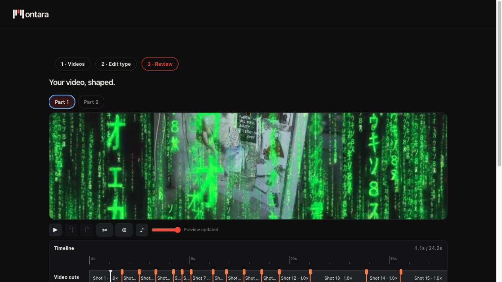
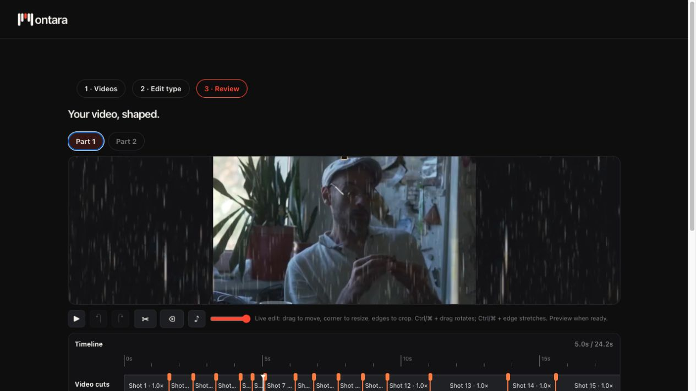
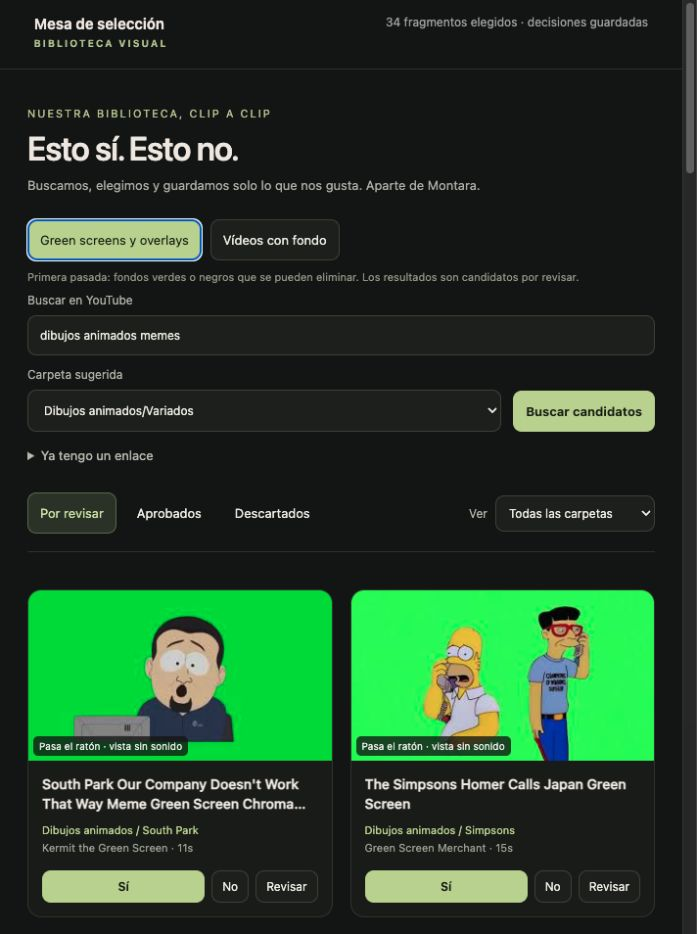
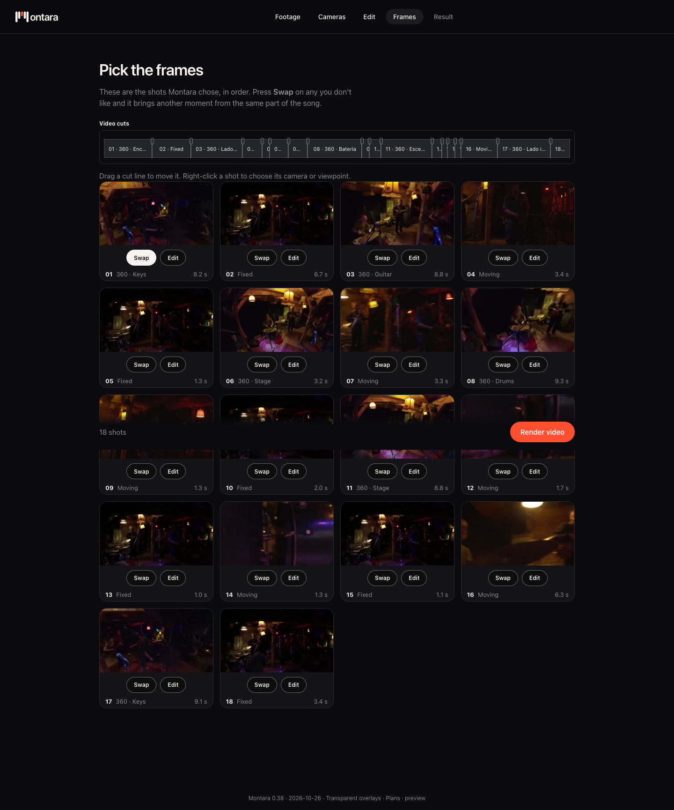
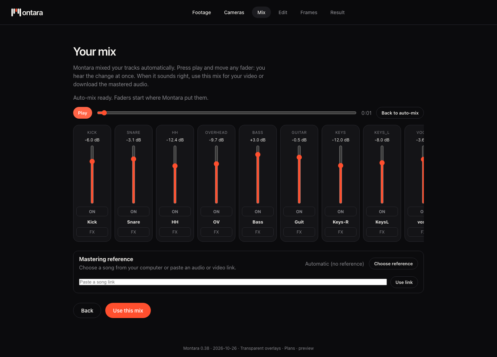
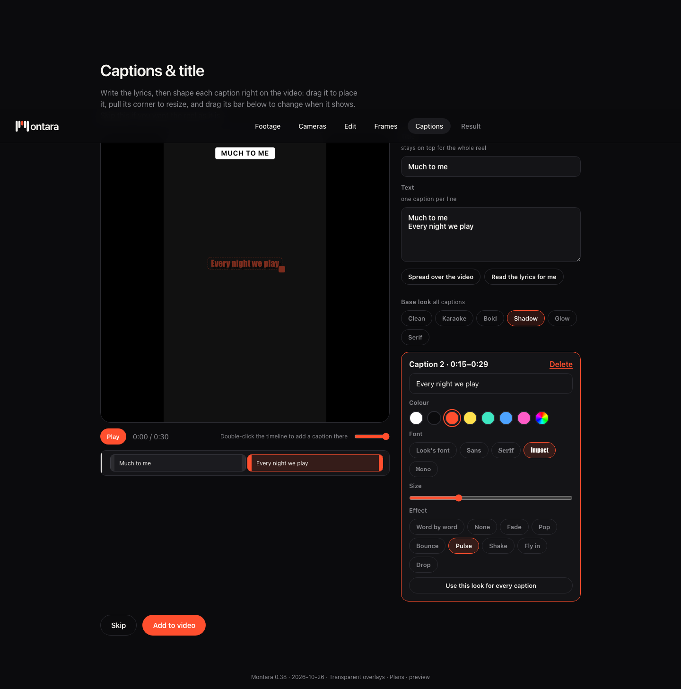

# Validation of the 0.38 continuation snapshot

- Parent-repository targeted tests: **13 passed** across chroma/library/source cache,
  private-access foundation and mixer FX-level tests.
- Mixer dependency: **13 passed** in test_noise_safety.py, including quiet musical audio.
- Portable selector check: two real MP4 cuts and durations, disk persistence,
  duplicate Yes handling, reversible No, and moving physical files between collections.
- Deployment builder reconstructed **47 sources and 94 assets** from tracked inputs.
- Browser checks on equivalent 0.38 source: Matrix letters over the original video
  while editing, keyed rain and snow, card autoplay, per-series filtering, separate
  full-background pass and visible Yes/No/Review actions.

These are targeted checks, not a full E2E certification or a commercial-readiness audit.
The public preview was already deployed as 0.38 before this source handoff.

## Shared main integration — 27 October 2026

All **73 Montara regression tests passed** locally and on Linux. Missing local
proxy source files and the separate Show example inputs were restored from the
existing local project. The current splash/frame-card navigation is covered by
the updated browser journey.

The complete Linux journey in [run 40418744759](https://github.com/amehcgracia-byte/Montara/actions/runs/40418744759)
reported `passed: true` for all three cases, including full output decoding:

| Journey | Output | Verification |
| --- | --- | --- |
| Stage | 100.23 s, 1920×1080 | Audio, all three cameras, frame swap, no excluded clips |
| Push | 30 s, 1080×1920 | Audio, burned captions, frame swap |
| Mixer + Stage | 100.23 s, 1920×1080 | Master generated by Mixer, all three cameras, frame swap |

The newer parallel [run 40420842307](https://github.com/amehcgracia-byte/Montara/actions/runs/40420842307)
also passed the Linux regression step and the Push and Mixer export steps.
GitHub marked those jobs red only because diagnostic artifact storage was full.
Artifact upload is now optional with three-day retention; failed tests and failed
exports still fail the job. No existing stored artifacts were deleted.

Local Stage and Push exports also passed. The following locally generated
screenshots were visually inspected, alongside extracted output frames. Linux
screenshots could not be retrieved because the artifact upload was rejected.
This checks the baseline and these journeys, not every Show interaction,
external service or commercial readiness. No production deployment was changed.

